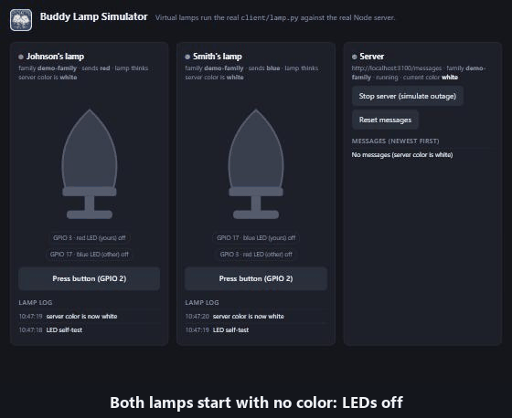

<p align="center">
  
</p>

<h1 align="center">buddy-lamp</h1>

<p align="center">A wifi lamp project. Press the button on your lamp and your buddy's lamp lights up in your color.</p>

## See it work (no hardware needed)

<p align="center">
  
</p>

The [simulator](#simulator-no-raspberry-pi-needed) runs the real server and the real lamp code with fake hardware, so you can try everything on your computer.

## How it works

```
 Lamp A (button)                Server                 Lamp B
      |  POST /messages  ->  saves "red"                  |
      |                         |  <-  GET /messages  every few seconds
      |                         |  ->  {"color": "red"}  -> lights up
```

* Each lamp has a button and two LEDs: one for **your** color, one for **the other** color.
* Press the button: your lamp tells the server your color and lights your LED.
* Every few seconds each lamp asks the server for the current color and lights the matching LED. The server just remembers the last color sent.
* If your color is already the active one, pressing the button does nothing.
* Lamps with the same **family** name share a color. Other families on the same server never see it.
* Every request carries a shared **secret** (like a password) so strangers can't change your lamp.

If something goes wrong (server unreachable, wrong secret, ...) the lamp **blinks both LEDs twice** and goes back to showing the last color. While the server is down the lamp retries less and less often (5s, 10s, 20s... up to 60s) and recovers by itself.

## Server

### Quick setup (Raspberry Pi or any Debian-style Linux)

```
cd buddy-lamp/server
./install.sh
```

It installs the packages, creates `server/.env` with a random secret (and prints it, you need it for the lamps), and sets the server to start on every boot. Check it with `curl http://localhost:3000/health`.

To see logs: `journalctl -u buddy-lamp-server -f`.

### Settings (`server/.env`)

| Variable | Meaning |
| --- | --- |
| `BUDDY_LAMP_SECRET` | Shared password, 8+ characters. Every lamp needs the same value. The server won't start without it. |
| `PORT` | Port to listen on (default 3000) |

See `server/.env.example`. Never commit `.env` (it's in `.gitignore`).

### Port forwarding

To use lamps outside your home network, forward the server's port on your router (or host the server somewhere public).

### Hosting on Render

Create a Web Service with root directory `server`, build command `npm install`, start command `npm start`, health check path `/health`, and set `BUDDY_LAMP_SECRET` under Environment. Render sets `PORT` itself.

Free instances sleep after a while without requests, so the first request can take a minute (the lamps just retry). Free instances also lose their files on restart, which resets the color to white.

### API

All `/messages` requests need the headers `X-Buddy-Secret` and `X-Buddy-Family` (1-32 characters: a-z, 0-9, `-`, `_`).

| Request | Result |
| --- | --- |
| `GET /messages` | `{"color": "red"}` (`white` if nothing sent yet) |
| `POST /messages` with `{"household": {"name": "Johnson", "color": "red"}}` | `201`. Name is 1-32 characters. Colors: `white`, `blue`, `red`, `green` |
| `GET /health` | `{"status": "ok"}` (no auth) |

Errors: `400` bad input or family, `401` wrong or missing secret.

## Lamp (client)

### Parts and wiring (Raspberry Pi, GPIO/BCM numbers)

* Button on GPIO 2
* "Yours" LED on GPIO 3 (red) and "other" LED on GPIO 17 (blue)
* If your color is **blue**, swap them: the LED for your color must be the "yours" LED (set `BUDDY_LAMP_MINE_LED_PIN=17` and `BUDDY_LAMP_OTHER_LED_PIN=3`; the installer does this for you).

### Quick setup

```
cd buddy-lamp/client
./install.sh
```

It installs what it needs, asks for your settings, and sets the lamp to start by itself on every boot. When it starts, each LED lights once as a self-test. To check on it: `journalctl -u buddy-lamp-client -f`.

### Settings (`client/.env`)

| Variable | Meaning |
| --- | --- |
| `BUDDY_LAMP_URL` | Server address, ending in `/messages` |
| `BUDDY_LAMP_FAMILY` | Your family group name. Same on every lamp that should share a color |
| `BUDDY_LAMP_SECRET` | Same as the server's `BUDDY_LAMP_SECRET` |
| `BUDDY_LAMP_NAME` | Who this lamp is (max 32 characters) |
| `BUDDY_LAMP_COLOR` | `red`, `blue` or `green` |
| `BUDDY_LAMP_BUTTON_PIN`, `BUDDY_LAMP_MINE_LED_PIN`, `BUDDY_LAMP_OTHER_LED_PIN` | Optional wiring overrides |

See `client/.env.example`. To change settings later, edit `.env` and run `sudo systemctl restart buddy-lamp-client`.

### Troubleshooting

| What you see | Likely cause |
| --- | --- |
| LEDs blink twice, log says "rejected the secret" | `BUDDY_LAMP_SECRET` differs from the server's |
| LEDs blink twice, log says "check BUDDY_LAMP_FAMILY..." | Invalid family, name or color |
| LEDs blink twice, log says "Request error" | Server down or unreachable (wifi, URL, port forwarding) |
| Nothing lights up | Check `journalctl -u buddy-lamp-client -f`, the wiring, and that the lamp's family matches the others |

## Simulator (no Raspberry Pi needed)

Runs the real server and two virtual lamps using the real client code (`client/lamp.py`) on a fake GPIO, with a web page to watch and poke them.

* Requirements: Python 3 with `requests`, Node.js, and `npm install` run once in `server/`.
* Run `python simulator/sim.py`, then open http://localhost:8765.
* Press either lamp's button, watch the other lamp light up, stop/start the server to see the error blink and recovery, reset the messages.
* The simulator uses its own throwaway data folder, secret and port (3100), so your real data is never touched.

Options: `--port` (UI, default 8765), `--server-port` (default 3100), `--poll` (seconds between lamp polls, default 1).

## Tests

* Server: `cd server && npm test`
* Client: `python -m unittest discover -s simulator/tests -v`
